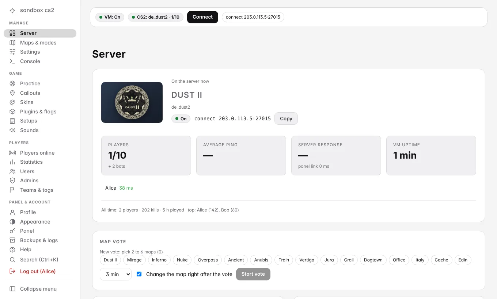
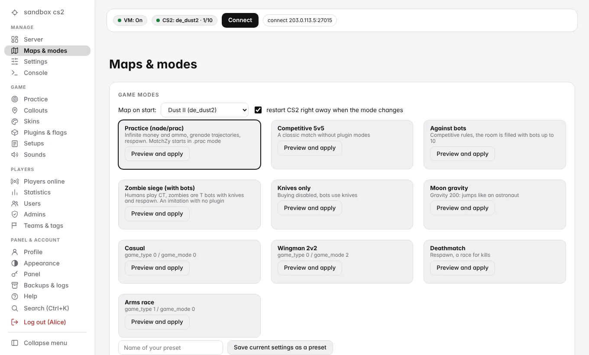
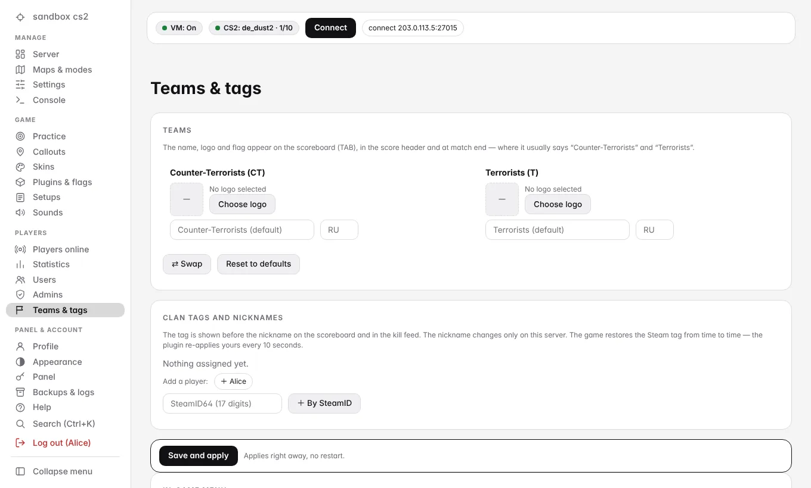
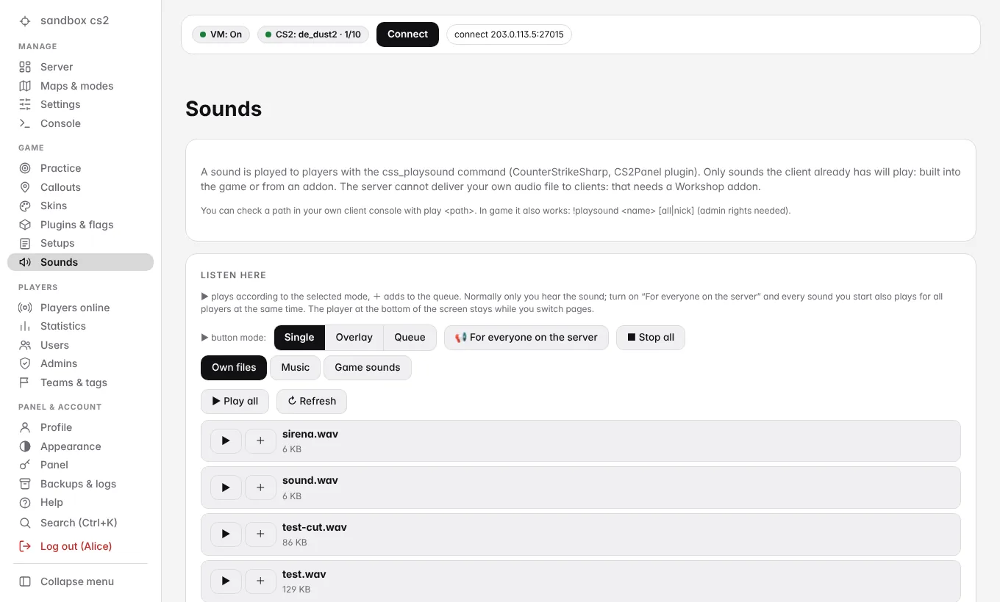
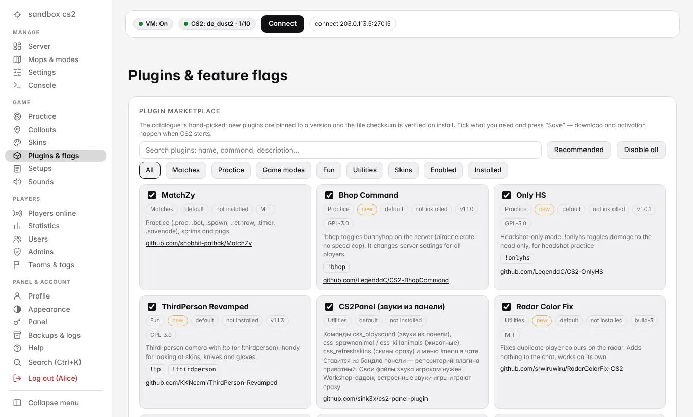

# cs2-server-admin-panel

**A persistent Counter-Strike 2 practice server on Yandex Cloud with a web admin panel.**
Pay only for the hours you play: the panel starts and stops the game VM for you.

English · [Русский](README.ru.md)

> **Try it in one minute, no cloud account needed:** `git clone https://github.com/sink3x/cs2-server-admin-panel && cd cs2-server-admin-panel && npm run demo`
> opens the real panel on a mock game server at <http://127.0.0.1:8080> (`admin` / `demo-admin-pass`). Needs Node.js 18+.

## What you get

- **A cheap private CS2 server for friends.** Two small VMs: a game VM (2 vCPU / 8 GB, billed only while it runs) and a tiny always-on panel VM.
  Everything that matters lives on a separate data disk and is backed up to Object Storage.
- **A web panel** (HTTPS, English / Russian / German / French, installable as a PWA, works on a phone):
  start / stop the VM, live status, RCON console, ~60 grouped cvars, game modes and map presets, map vote, 120+ Workshop maps with previews and tags,
  practice tools and callouts for 10 maps, skins / knives / gloves / agents, a sound player (also *on the server, for everybody at once*),
  per-player statistics and heatmaps, team names / logos / clan tags, plugin switches, backups and restore, audit log, auto-stop when nobody is online.
- **An in-game menu** (`!menu`) from the bundled [CS2Panel plugin](https://github.com/sink3x/cs2-server-admin-plugin).
- **Infrastructure as code** (OpenTofu / Terraform), a deterministic deploy bundle, optional continuous deployment from GitHub Actions.
- **Zero npm dependencies on the servers.** The backend is plain Node.js; only the frontend build tooling uses npm.

| | |
|---|---|
|  |  |
|  |  |

## Quick start

1. **Look around** (no cloud needed): `npm run demo`, see above.
2. **Deploy your own server** (about 20 minutes plus the first 60 GB game download):
   - open [Yandex Cloud Shell](https://shell.yandex.cloud/) (it has `yc` and Terraform),
   - `git clone https://github.com/sink3x/cs2-server-admin-panel && cd cs2-server-admin-panel`,
   - put your cloud / folder ids and your SteamID64 into `terraform/terraform.tfvars` (start from `terraform.tfvars.example`),
   - `scripts/deploy.sh`.

   The script prints the panel URL and the first logins. Full walkthrough with prerequisites, costs, the Steam server token and troubleshooting:
   **[docs/installation.md](docs/installation.md)** ([по-русски](docs/ru/installation.md)).

## Documentation

| Document | What is inside |
|---|---|
| [Installation](docs/installation.md) | From zero to a running server, GSLT, first login, updating, removing everything |
| [Stack and structure](docs/stack.md) | **What runs where and on which technology**, with a map of the repository ([RU](docs/ru/stack.md)) |
| [Architecture](docs/architecture.md) | Components, boot sequence, state rendering, backups, security boundaries |
| [Configuration](docs/configuration.md) | Terraform variables, `state.json`, panel settings, environment variables |
| [Plugins](docs/plugins.md) | The plugin catalogue, the CS2Panel menu and commands, team and player identity |
| [Development](docs/development.md) | Run tests, demo mode, build the frontend, add a map / translation / plugin, cut a release |
| [FAQ and limits](docs/faq.md) | What a server *cannot* do (client-side UI), skin-changer risks, common problems |
| [Security policy](SECURITY.md) | Threat model, reporting a vulnerability |
| [Changelog](CHANGELOG.md), [Third-party notices](THIRD_PARTY.md) | |

## The family of repositories

| Repository | Purpose |
|---|---|
| **[cs2-server-admin-panel](https://github.com/sink3x/cs2-server-admin-panel)** (this one) | Infrastructure, admin panel, agent, deploy scripts |
| [cs2-server-admin-plugin](https://github.com/sink3x/cs2-server-admin-plugin) | CounterStrikeSharp plugin: `!menu`, sounds, team names / logos / clan tags, animals, cleanup |
| [cs2-server-admin-callouts](https://github.com/sink3x/cs2-server-admin-callouts) | Callout positions for 10 maps (ru / en / de / fr), the data behind the panel's Callouts page |

The panel ships a copy of the CS2Panel plugin (`app/plugins-bundled/CS2Panel.zip`) and the callouts data (`app/lib/callouts.json`);
they are updated from the other repositories' releases.

## Honest limits

- **Not affiliated with Valve.** "Counter-Strike" is a trademark of Valve Corporation.
- **Skin changers violate Valve's server guidelines.** The WeaponPaints plugin is *on by default but optional*; a server using it can get its
  Game Server Login Token banned. Use a secondary Steam account for the token, or switch the plugin off in the panel.
- A server cannot restyle the client UI: the bottom T/CT side icons and the layout of the TAB scoreboard stay as the game draws them.
  What it *can* change (team names, logos from the game files, flags, clan tags, nicknames) is on the **Teams & tags** page.
- Sounds you upload to the panel can be played in the panel, but players only hear sounds their game already has
  (built-in game sounds or a Workshop addon).
- Supported out of the box: Yandex Cloud only. Porting the Terraform module to another cloud is welcome (see [CONTRIBUTING](CONTRIBUTING.md)).

## Contributing

Issues and pull requests are welcome. Start with [CONTRIBUTING.md](CONTRIBUTING.md); `npm run demo` and `npm test` need nothing but Node.js.

## License

[MIT](LICENSE) © 2026 sink3x. Third-party software that the server downloads at install time (Metamod, CounterStrikeSharp, MatchZy,
WeaponPaints, ...) keeps its own licenses, see [THIRD_PARTY.md](THIRD_PARTY.md).
