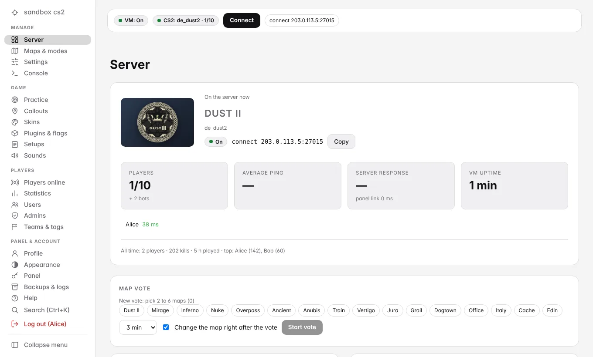
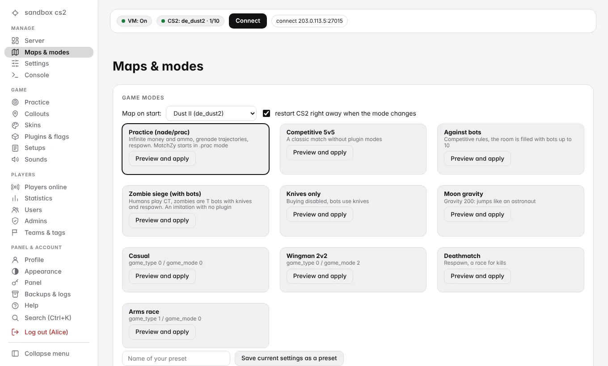
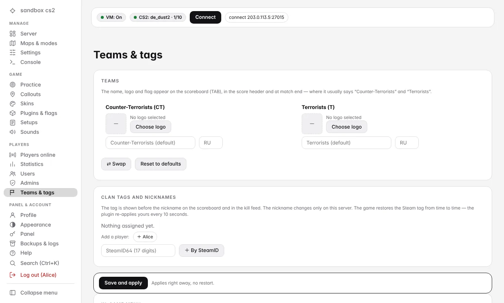
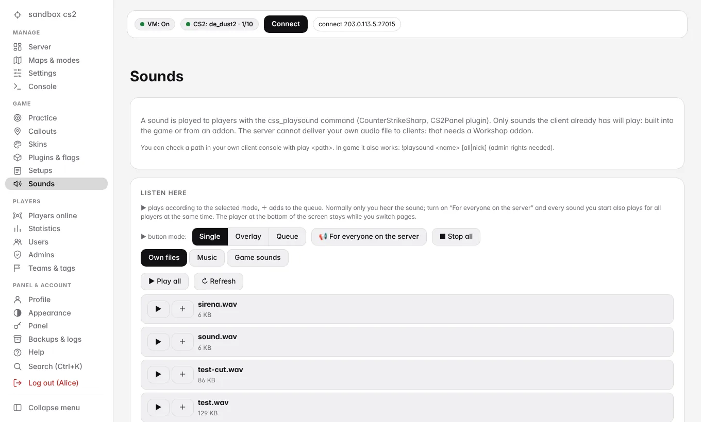
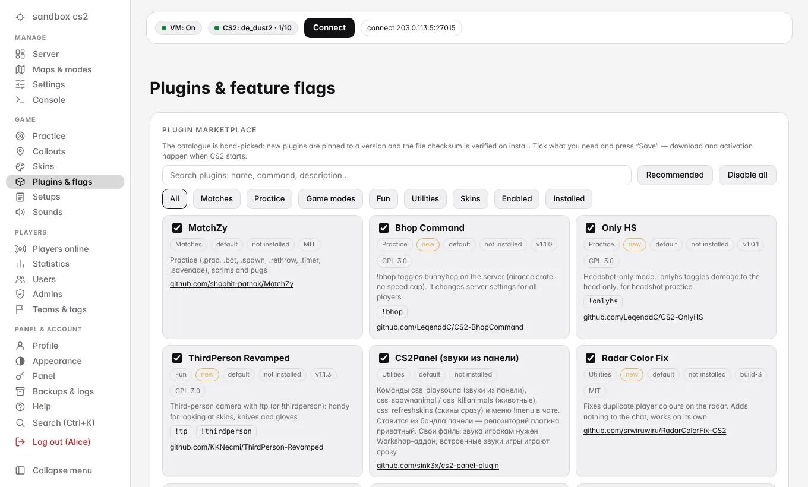

# cs2-yc-sandbox

**Постоянный сервер Counter-Strike 2 для тренировок в Yandex Cloud и веб-панель управления им.**
Платите только за часы игры: панель сама включает и выключает игровую ВМ.

[English](README.md) · Русский

> **Попробовать за минуту, без облака:** `git clone https://github.com/sink3x/cs2-yc-sandbox && cd cs2-yc-sandbox && npm run demo`
> откроет настоящую панель с имитацией игрового сервера: <http://127.0.0.1:8080> (`admin` / `demo-admin-pass`). Нужен Node.js 18+.

## Что внутри

- **Недорогой приватный сервер CS2 для друзей.** Две небольшие ВМ: игровая (2 vCPU / 8 ГБ, оплата только пока она включена) и крошечная панельная, которая работает всегда.
  Всё важное лежит на отдельном диске данных и копируется в Object Storage.
- **Веб-панель** (HTTPS, русский / английский / немецкий / французский, ставится как PWA, удобна с телефона):
  включение и выключение ВМ, состояние сервера, RCON-консоль, около 60 настроек (cvars) по группам, режимы и пресеты карт, голосование за карту,
  больше 120 карт Workshop с превью и тегами, тренировка и callouts для 10 карт, скины, ножи, перчатки, агенты, плеер звуков
  (в том числе *на сервере, сразу у всех игроков*), статистика игроков и тепловые карты, названия команд, логотипы и клан-теги,
  переключатели плагинов, бэкапы и восстановление, журнал действий, автовыключение, когда на сервере никого нет.
- **Меню прямо в игре** (`!menu`) из плагина [CS2Panel](https://github.com/sink3x/cs2-panel-plugin).
- **Инфраструктура как код** (OpenTofu / Terraform), детерминированная сборка для деплоя, необязательный автодеплой из GitHub Actions.
- **На серверах нет npm-зависимостей.** Бэкенд — чистый Node.js; npm нужен только для сборки фронтенда.

| | |
|---|---|
|  |  |
|  |  |

## Быстрый старт

1. **Посмотреть** (облако не нужно): `npm run demo`, см. выше.
2. **Развернуть свой сервер** (около 20 минут и ещё время на первую загрузку игры, ~60 ГБ):
   - откройте [Yandex Cloud Shell](https://shell.yandex.cloud/) (в нём есть `yc` и Terraform),
   - `git clone https://github.com/sink3x/cs2-yc-sandbox && cd cs2-yc-sandbox`,
   - впишите идентификаторы облака и каталога и свой SteamID64 в `terraform/terraform.tfvars` (за основу возьмите `terraform.tfvars.example`),
   - `scripts/deploy.sh`.

   Скрипт напечатает адрес панели и первые логины. Подробная инструкция с требованиями, стоимостью, токеном игрового сервера Steam и разбором проблем:
   **[docs/ru/installation.md](docs/ru/installation.md)**.

## Документация

| Документ | Что внутри |
|---|---|
| [Установка](docs/ru/installation.md) | От нуля до работающего сервера, токен GSLT, первый вход, обновление, удаление всего |
| [Стек и структура](docs/ru/stack.md) | **Что где работает и на какой технологии**, карта репозитория ([EN](docs/stack.md)) |
| [Архитектура](docs/architecture.md) | Компоненты, последовательность загрузки, как собирается состояние, бэкапы, границы безопасности (на английском) |
| [Конфигурация](docs/configuration.md) | Переменные Terraform, `state.json`, настройки панели, переменные окружения (на английском) |
| [Плагины](docs/plugins.md) | Каталог плагинов, меню и команды CS2Panel, оформление команд и игроков (на английском) |
| [Разработка](docs/development.md) | Тесты, demo-режим, сборка фронтенда, как добавить карту, перевод, плагин, как выпустить релиз (на английском) |
| [FAQ и ограничения](docs/faq.md) | Чего сервер *не может* (клиентский интерфейс), риски скинченджера, частые проблемы (на английском) |
| [Политика безопасности](SECURITY.md) | Модель угроз, как сообщить об уязвимости |
| [Журнал изменений](CHANGELOG.md), [Сторонние компоненты](THIRD_PARTY.md) | |

## Семейство репозиториев

| Репозиторий | Назначение |
|---|---|
| **[cs2-yc-sandbox](https://github.com/sink3x/cs2-yc-sandbox)** (этот) | Инфраструктура, админ-панель, агент, скрипты деплоя |
| [cs2-panel-plugin](https://github.com/sink3x/cs2-panel-plugin) | Плагин CounterStrikeSharp: `!menu`, звуки, названия и логотипы команд, клан-теги, животные, очистка карты |
| [cs2-callouts](https://github.com/sink3x/cs2-callouts) | Схемы карт и позиции callouts для 10 карт (ru / en / de / fr): данные для страницы «Callouts» |

Панель содержит копию плагина CS2Panel (`app/plugins-bundled/CS2Panel.zip`) и данные callouts (`app/lib/callouts.json`);
они обновляются из релизов соседних репозиториев.

## Честные ограничения

- **Проект не связан с Valve.** «Counter-Strike» — товарный знак Valve Corporation.
- **Скинченджеры нарушают правила Valve для серверов.** Плагин WeaponPaints включён по умолчанию, но не обязателен; сервер с ним может потерять
  токен игрового сервера (GSLT). Используйте для токена второстепенный аккаунт Steam или отключите плагин в панели.
- Сервер не может переделать клиентский интерфейс: нижние значки сторон T/CT и раскладка таблицы TAB остаются такими, как их рисует игра.
  Менять можно названия команд, логотипы из файлов игры, флаги, клан-теги и ники: это страница **«Команды и теги»**.
- Звуки, загруженные в панель, играют в самой панели; игроки слышат только то, что уже есть у их игры
  (встроенные звуки или аддон из Workshop).
- Из коробки поддерживается только Yandex Cloud. Перенос модуля Terraform на другое облако приветствуется (см. [CONTRIBUTING](CONTRIBUTING.md)).

## Участие

Issues и pull request приветствуются. Начните с [CONTRIBUTING.md](CONTRIBUTING.md); для `npm run demo` и `npm test` нужен только Node.js.

## Лицензия

[MIT](LICENSE) © 2026 sink3x. Сторонние программы, которые сервер скачивает при установке (Metamod, CounterStrikeSharp, MatchZy,
WeaponPaints и другие), сохраняют свои лицензии, см. [THIRD_PARTY.md](THIRD_PARTY.md).
