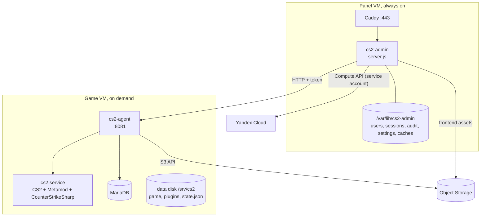
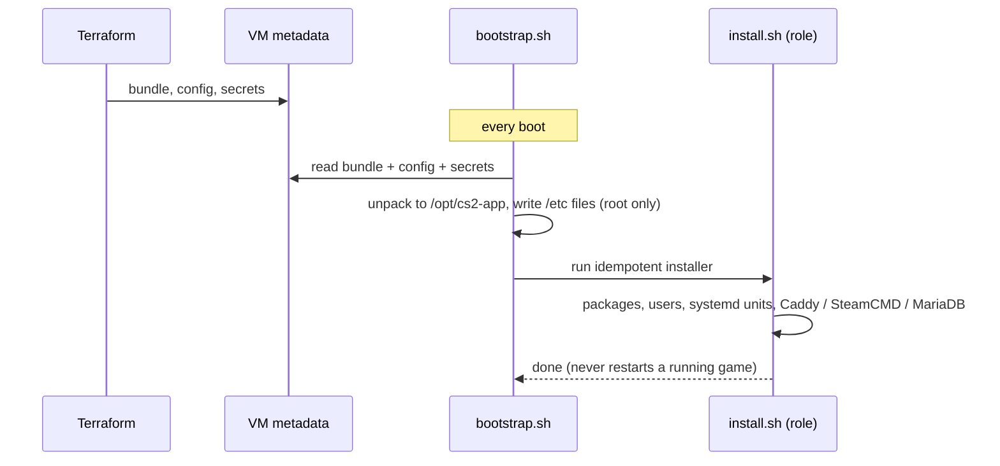

# Architecture

How the pieces fit together at run time. For *which technology is used where*, see [stack.md](stack.md).

## Components

- **Admin panel** (`app/admin/server.js`): authentication, roles, the JSON API, VM control, audit log, auto-stop. It is the only thing exposed to the internet besides the game port.
- **Agent** (`app/agent/`): runs on the game VM next to the game. It owns everything that touches the game: configs, RCON, plugins, skins, backups.
- **Game server**: CS2 with Metamod:Source and CounterStrikeSharp. Plugins are normal CounterStrikeSharp plugins; the first-party one is [CS2Panel](https://github.com/sink3x/cs2-panel-plugin).

## One source of truth: `state.json`

All server settings live in a single `state.json` on the data disk (schema in `app/lib/state.js`, validated on every write). Top-level keys:
`version`, `server`, `cvars`, `flags`, `plugins`, `admins`, `maps`, `sounds`, `identity`.

The panel edits it through the agent. The agent **renders** it into the files the game reads (`server.cfg`, override cfgs, `admins.json` for CounterStrikeSharp, MatchZy admins, sound and identity configs, the launch command line). Rendering is deterministic and covered by tests (`state.test.js`, `apply.test.js`); a hand edit of a generated file is overwritten at the next apply.

If the panel VM is recreated, it reads the state back from the agent. If the data disk is recreated, the agent restores the latest backup.

## Boot sequence

Game VM extras: `cs2-block-metadata.service` adds a firewall rule that rejects traffic from the `steam` user to the cloud metadata address, so game plugins cannot read the VM's secrets or tokens (best effort: if `iptables` is missing it logs and lets the game start). `prestart.js` runs before each game start: restore from backup if the disk is empty, SteamCMD update, plugin installation and pinning, config rendering. `launch.js` then builds the server command line from `state.json`.

## Cost model: the VM that sleeps

- The panel calls the Compute API (`start` / `stop`) with the **panel service account** (`compute.operator` and `storage.viewer`, granted on the folder).
- **Auto-stop**: every minute the panel asks the agent how many human players are connected. After `startupGraceMinutes` (default 20) it starts counting; with zero players for `autoStopIdleMinutes` (default 30) it stops the VM. Both are editable in the panel settings; `0` disables auto-stop.
- **Shutdown** triggers a backup (`cs2-backup-shutdown.service`) so a stopped VM always has a fresh copy in Object Storage. A nightly timer adds one more.
- The data lives on a separate persistent disk, so stopping or even recreating the VM keeps the game files, plugins, skins and statistics.

## Security boundaries

| Boundary | Protection |
|---|---|
| Internet to panel | HTTPS (Let's Encrypt), session cookies (HttpOnly, SameSite), login rate limiting, scrypt password hashes; optional Steam OpenID; optional CIDR allow-list in the security group |
| Panel roles | `admin` (everything), `player` (status, own profile, optional start), checked per route on the server |
| Panel to agent | Private network only, port 8081 reachable from the panel's security group, bearer token. The agent is never exposed to the internet; the panel offers its own typed routes (role-checked) and calls the agent from them. RCON batches are limited to 25 commands of at most 500 characters, without line breaks |
| Game to cloud | The game VM's service account has `storage.editor` on the folder and nothing else (no Compute access); the metadata endpoint is blocked for the game user. Use a dedicated folder |
| Secrets | Terraform variables to VM metadata to root-only files; never in the repository, logs or the frontend |
| Supply chain | Node backend has no npm dependencies; frontend build dependencies are pinned and watched by Dependabot; CI runs CodeQL and gitleaks; third-party game plugins can be version-pinned |
| CI deploy | Off by default; runs only for pushes to `main` of the same repository, secrets in a protected environment |

The threat model and how to report a vulnerability are in [SECURITY.md](../SECURITY.md).

## Frontend delivery

`scripts/pack.sh` builds two things: the **application bundle** (`build/bundle.tgz`, backend + agent + installers, shipped in VM metadata and kept deterministic so `plan` is clean when nothing changed) and the **minified public frontend** (`build/public`, shipped separately). Metadata values have a size limit of about 256 KB, which is why the frontend is split from the bundle and why `pack.sh` fails loudly when a limit is exceeded. The panel VM serves the frontend itself; a service worker and a manifest make it installable as a PWA.

## Data model at a glance

| Data | Format | Written by |
|---|---|---|
| Server settings | `state.json` | agent (from panel requests) |
| Panel users, sessions, audit, settings | JSON files, atomic writes | panel |
| Skins | MariaDB (WeaponPaints schema) | agent / plugin |
| Player statistics | JSON built by the agent from the game server log (`cs2.service` journal) | agent |
| Backups | `tar.gz` in Object Storage (last 14) | agent |

There is deliberately no database for the panel itself: a handful of users and a few hundred audit lines do not justify one, and files survive reinstalls through the Terraform-seeded users.
