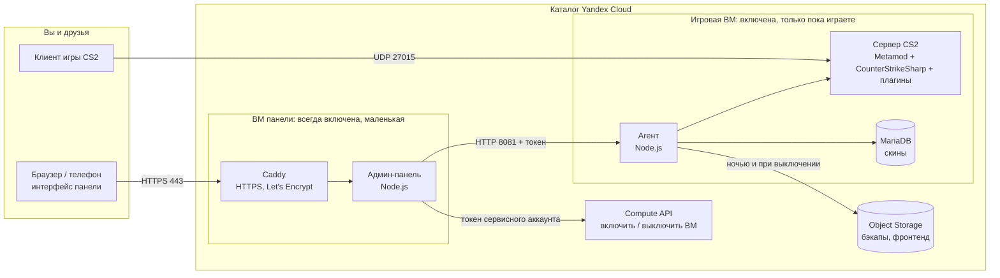

# Стек и структура: что где работает и на какой технологии

*English version: [docs/stack.md](../stack.md).*

Эта страница отвечает на три вопроса: **из каких частей состоит проект, где работает каждая часть и на чём она написана.**
Почему выбраны именно эти технологии — в [ADR 0001](../adr/0001-admin-stack.md); как всё работает во время жизни сервера — в [architecture.md](../architecture.md) (на английском).

## 1. Картина за 30 секунд



| Слой | Технология | Одной строкой |
|---|---|---|
| Облако | **Yandex Cloud**: Compute, VPC, IAM, Object Storage | Две ВМ, одна сеть, один бакет |
| Инфраструктура как код | **OpenTofu / Terraform** (>= 1.6), провайдер `yandex-cloud/yandex` | `terraform/` |
| ОС | **Ubuntu 24.04 LTS** на обеих ВМ | Пакеты из архива Ubuntu; Node.js >= 18 |
| Бэкенд панели | **Node.js**, CommonJS, **без npm-зависимостей** | `app/admin/server.js`, `app/lib/` |
| Фронтенд панели | Страницы на **чистом JS** + «острова» на **Preact 11 / TypeScript 7 / Vite 8** | `app/admin/public/`, `web/` |
| Агент (на игровой ВМ) | **Node.js**, без зависимостей | `app/agent/` |
| Игровой сервер | **Выделенный сервер CS2** + **Metamod:Source** + **CounterStrikeSharp** | ставится агентом через SteamCMD |
| Плагины игры | **C# / .NET** (CounterStrikeSharp) | [cs2-panel-plugin](https://github.com/sink3x/cs2-panel-plugin) наш; MatchZy, WeaponPaints и другие сторонние |
| Данные | **JSON-файлы** + **MariaDB** (скины) + **Object Storage** (бэкапы) | Отдельной БД для самой панели нет |
| TLS / обратный прокси | **Caddy** (автоматический Let's Encrypt на `<ip>.sslip.io`) | `vm-admin/install.sh` |
| Доставка | Детерминированный `tar.gz` в **метаданных ВМ** + фронтенд в **Object Storage** | `scripts/pack.sh` |
| CI/CD | **GitHub Actions**: CI, Release, Deploy (OpenTofu), CodeQL, Dependabot | `.github/` |
| Тесты | **`node:test`** (160+ тестов), xUnit для плагина, `unittest` для callouts | см. раздел 7 |

## 2. Где что работает

### ВМ панели (`<префикс>-panel`, всегда включена, 2 vCPU с долей 20% / 1 ГБ)
- **Caddy** принимает HTTPS (порты 80/443) и проксирует на панель `127.0.0.1:8080`.
- **cs2-admin.service**: сама панель (`node app/admin/server.js`). Отдаёт интерфейс и JSON API, авторизует пользователей
  (пароли scrypt или Steam OpenID), включает и выключает игровую ВМ через Compute API токеном сервисного аккаунта этой ВМ
  и пересылает агенту разрешённый список запросов.
- **Данные**: `/var/lib/cs2-admin` (пользователи, сессии, журнал, настройки, кэши), конфиг и секреты в `/etc/cs2-admin`.
- **Код**: распаковывается из бандла в метаданных ВМ в `/opt/cs2-app`; минифицированный фронтенд приходит из Object Storage.

### Игровая ВМ (`<префикс>-game`, оплата только пока включена, по умолчанию 2 vCPU / 8 ГБ)
- **cs2.service**: выделенный сервер CS2 от непривилегированного пользователя `steam`.
- **cs2-agent.service**: агент (`node app/agent/agent.js`), HTTP API в приватной сети (порт 8081, токен). Он превращает
  `state.json` в конфиги, выполняет RCON, управляет плагинами и скинами, достаёт звуки игры, делает бэкапы.
- **MariaDB** хранит данные WeaponPaints (скины). **SteamCMD** ставит и обновляет игру.
- **Диск данных** (`/srv/cs2`, по умолчанию 100 ГБ, отдельный от загрузочного, переживает пересоздание ВМ): файлы игры, плагины, конфиги, `state.json`, БД.
- Бэкапы уходят в **Object Storage** каждую ночь и при каждом выключении; если диск данных пуст, при запуске восстанавливается свежий бэкап.

### Сервисы Yandex Cloud
Compute (2 ВМ, 1 диск данных), VPC (сеть, подсеть, группы безопасности, 2 статических IP), IAM (сервисные аккаунты панельной и игровой ВМ),
Object Storage (бакет бэкапов, архив фронтенда). Больше ничего: ни управляемых БД, ни балансировщиков.

### Ваш компьютер / Cloud Shell
Нужны только для деплоя: `yc`, `tofu` или `terraform`, `python3`, `node` (сборка фронтенда), `git`.

## 3. Компоненты подробно

### 3.1 Бэкенд панели: `app/admin/server.js`, `app/lib/`
- **Node.js >= 18, CommonJS, ноль зависимостей.** Встроенные `node:http`, `node:crypto`, `node:test`.
- Вместо фреймворков: небольшие протестированные модули. `auth.js` (scrypt, сессии, ограничение попыток), `http.js`, `rcon.js` (клиент Source RCON),
  `s3.js` (клиент AWS SigV4 для Object Storage), `yc.js` (клиент Compute API), `state.js` (модель состояния, проверка и генераторы конфигов),
  `catalog.js` (кэш каталога скинов), `workshop.js` (метаданные Steam Workshop), `soundfiles.js`, `vote.js`, `uptime.js`, `ipgeo.js`.
- Почему без фреймворка: панель — тонкий слой (HTTP API, RCON, прокси к агенту), узкое место никогда не CPU, а каждая зависимость
  ехала бы в бандл с ограниченным размером и требовала бы аудита.

### 3.2 Фронтенд панели: `app/admin/public/`, `web/`
- **Классические страницы** на чистом JavaScript: маленький помощник `h()` собирает DOM, страницы лежат в `pages-*.js`, оболочка — `shell.js`,
  стили — один `style.css` на CSS-переменных. PWA: сервис-воркер `sw.js` и манифест.
- **Острова** на **Preact 11 + TypeScript 7**, сборка **Vite 8** в `app/admin/public/ui/` (исходники в `web/src/`): Callouts, Игроки онлайн,
  Файлы звуков, Обрезка. Новые страницы пишутся так; старые переезжают постепенно.
- **Публичная сборка**: `web/build-public.mjs` (esbuild) минифицирует, режет на ленивые чанки и убирает комментарии; на ВМ едет только `build/public/`.
- **i18n**: исходный язык — русский; `en`, `de`, `fr` берутся из словарей (`i18n*.js`). Тест падает, если в записи словаря нет языка или в переводе осталась кириллица.

### 3.3 Агент: `app/agent/`
Node.js без зависимостей. Точки входа: `prestart.js` (восстановление, обновление, настройка перед запуском игры), `launch.js` (строит командную строку CS2 из `state.json`),
`agent.js` (HTTP API), `backup.js`, `install.js` (SteamCMD, Metamod, CounterStrikeSharp, плагины), `apply.js` (генерация конфигов), `skins.js` (MariaDB), `music.js`
(достаёт звуки и логотипы команд через Source2Viewer-CLI), `stats.js`, `cleanup.js`.

### 3.4 Стек игрового сервера (ставится во время работы, в этом репозитории не хранится)
CS2 (SteamCMD, app 730) -> **Metamod:Source** -> **CounterStrikeSharp** (хост C#-плагинов на .NET) -> плагины. Каталог плагинов — `app/lib/plugins.json`;
релизы скачиваются с GitHub при установке, версии можно закрепить.

### 3.5 Плагин CS2Panel (отдельный репозиторий)
**C# на .NET 10**, `CounterStrikeSharp.API` 1.0.379. Меню в игре, звуки, оформление команд и игроков, животные, очистка карты.
Собранная копия лежит в `app/plugins-bundled/CS2Panel.zip`. См. [cs2-panel-plugin](https://github.com/sink3x/cs2-panel-plugin).

### 3.6 Инфраструктура: `terraform/`, `common/`, `vm-admin/`, `vm-cs2/`
- Файлы Terraform: `network.tf`, `iam.tf`, `storage.tf`, `compute.tf`, `variables.tf`, `outputs.tf`, `versions.tf`.
- **Загрузка**: cloud-init запускает `cs2-bootstrap.service`, тот выполняет `common/bootstrap.sh`: читает бандл, конфиг и секреты из метаданных ВМ,
  распаковывает в `/opt/cs2-app` и при **каждой** загрузке запускает идемпотентный установщик роли (`vm-cs2/install.sh` или `vm-admin/install.sh`).
- **Юниты systemd** лежат в `vm-*/systemd/`. Повторный bootstrap никогда не перезапускает игровой процесс.

### 3.7 Данные callouts (отдельный репозиторий)
Скрипты на **Python 3** превращают данные навигационной сетки ([awpy](https://github.com/pnxenopoulos/awpy), MIT) в схематичные карты **WebP** и `callouts.json`. См. [cs2-callouts](https://github.com/sink3x/cs2-callouts).

## 4. Где хранится состояние

| Что | Где | Переживает пересоздание ВМ |
|---|---|---|
| Настройки сервера (единственный источник правды) | `state.json` на диске данных (`/srv/cs2`) + кэш на ВМ панели | Да (диск данных) и бэкапы |
| Файлы игры, плагины, конфиги плагинов | диск данных | Да |
| Скины | MariaDB на диске данных | Да, плюс дамп в каждом бэкапе |
| Бэкапы (последние 14) | бакет Object Storage | Да |
| Пользователи панели, сессии, журнал, настройки | `/var/lib/cs2-admin` на загрузочном диске ВМ панели | После пересоздания пусто; первые логины берутся из `panel_users` |
| Секреты (токен агента, RCON, БД, GSLT) | переменные Terraform -> метаданные ВМ -> файлы только для root | Применяются заново из `secrets.auto.tfvars` |
| Состояние Terraform | локальный файл или бакет Object Storage, если задан `TF_STATE_BUCKET` | Берегите: в нём те же секреты |

## 5. Сеть и порты

| Порт | Откуда | Куда | Зачем |
|---|---|---|---|
| UDP 27015 | интернет | игровая ВМ | трафик CS2 |
| TCP 443, 80 | `panel_allowed_cidrs` (по умолчанию все) | ВМ панели | HTTPS панели, проверка ACME и редирект |
| TCP 8081 | только группа безопасности панели | игровая ВМ | API агента (токен) |
| TCP 22 | `ssh_allowed_cidrs`, только если задан `ssh_public_key` | обе | необязательный SSH |
| RCON (27015/tcp) | только loopback | игровая ВМ | наружу не открыт |

## 6. CI/CD (`.github/`)

| Workflow | Когда | Что делает |
|---|---|---|
| `ci.yml` | push / pull request | тесты на Node 20 и 22, сборка бандла с проверкой лимита метаданных, проверка типов и сборка фронтенда, `fmt` / `validate` OpenTofu, gitleaks |
| `release.yml` | тег `v*` | тесты, архивы бандла и фронтенда, `SHA256SUMS`, аттестация происхождения, GitHub Release |
| `deploy.yml` | после зелёного CI на `main` (по желанию) | `tofu apply`, перезапуск ВМ панели, проверка, что отдаётся новый фронтенд |
| `codeql.yml` | push / раз в неделю | статический анализ |
| `dependabot.yml` | раз в неделю | обновления npm-пакетов `web/`, Actions, провайдеров Terraform |

## 7. Качество и тесты

| Что | Чем | Где |
|---|---|---|
| Бэкенд, агент, модель состояния, i18n, безопасность, demo | `node --test` (160+ тестов, без зависимостей) | `app/test/` |
| Типы фронтенда | `tsc --noEmit` | `web/` |
| Инфраструктура | `tofu fmt -check`, `tofu validate` | `terraform/` |
| Секреты в git | gitleaks | CI |
| Плагин | xUnit-тесты чистой логики | [cs2-panel-plugin](https://github.com/sink3x/cs2-panel-plugin) |
| Данные callouts | проверки схемы на Python `unittest` | [cs2-callouts](https://github.com/sink3x/cs2-callouts) |
| Вручную / демо | `npm run demo`: настоящая панель на имитации игрового сервера | `app/dev/demo.js` |

## 8. Карта репозитория

```
cs2-yc-sandbox/
|- app/
|  |- admin/            бэкенд панели (server.js) и классический фронтенд (public/)
|  |- agent/            агент, работает на игровой ВМ
|  |- lib/              общие библиотеки: модель состояния, RCON, S3, Compute API, пресеты, каталог плагинов, данные callouts
|  |- dev/demo.js       demo-режим (имитация игрового сервера)
|  |- plugins-bundled/  собранный плагин CS2Panel
|  `- test/             наборы node:test
|- web/                 острова Preact + TypeScript, build-public.mjs (минифицированная публичная сборка)
|- terraform/           инфраструктура Yandex Cloud
|- common/              bootstrap.sh: выполняется при каждой загрузке обеих ВМ
|- vm-admin/, vm-cs2/   идемпотентные установщики и юниты systemd для каждой роли ВМ
|- scripts/             deploy.sh, pack.sh, init-secrets.sh, вспомогательные set-*.sh
|- docs/                документация, ADR, скриншоты
`- .github/             workflows, шаблоны issue и PR, Dependabot
```

## 9. «Хочу изменить X: куда смотреть?»

| Задача | С чего начать |
|---|---|
| Добавить или изменить страницу панели | `app/admin/public/pages-*.js` (классика) или `web/src/pages/` (Preact), зарегистрировать в `shell.js` |
| Добавить маршрут API | `app/admin/server.js` (таблица маршрутов), ограничить по ролям |
| Изменить, что делает настройка сервера | `app/lib/state.js` (проверка и генераторы) |
| Добавить режим игры / пресет карты | `app/lib/presets.js` |
| Добавить карту Workshop | `WORKSHOP_MAPS` в `app/lib/presets.js` |
| Добавить или закрепить плагин | `app/lib/plugins.json` |
| Изменить размер ВМ, диски, сеть | `terraform/variables.tf`, `compute.tf`, `network.tf` |
| Изменить, что происходит при загрузке ВМ | `common/bootstrap.sh`, `vm-*/install.sh` |
| Добавить перевод | `app/admin/public/i18n-extra*.js` |
| Изменить меню в игре | [cs2-panel-plugin](https://github.com/sink3x/cs2-panel-plugin), `src/Plugin.cs` |

## 10. Честные замечания

- Фронтенд **в процессе миграции**: страниц на чистом JS пока большинство, «острова» Preact + TypeScript добавляются постранично (см. ADR).
- Сторонние игровые плагины скачиваются с GitHub при установке и работают внутри процесса игры. Панель закрывает им доступ к сервису метаданных облака,
  но если это важно, закрепляйте версии.
- Сегодня поддерживается только Yandex Cloud; для другого облака переносить нужно модуль Terraform.
