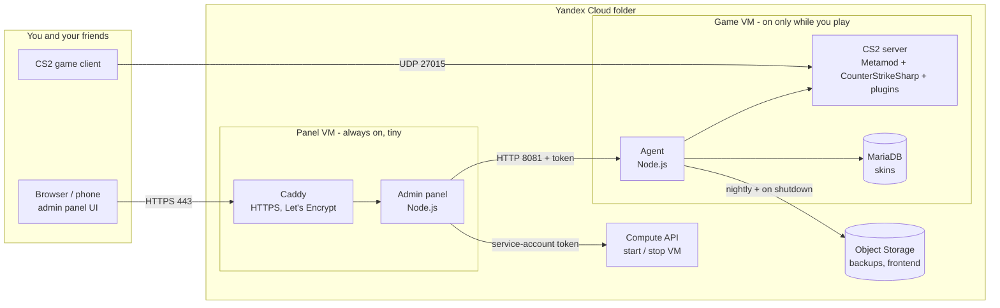

# Stack and structure: what runs where, on which technology

*Read in Russian: [docs/ru/stack.md](ru/stack.md).*

This page answers three questions: **what are the parts, where does each part run, and what is it built with.**
For the "why" behind the big choices see [ADR 0001](adr/0001-admin-stack.md); for the runtime flow see [architecture.md](architecture.md).

## 1. The 30-second picture



| Layer | Technology | One line |
|---|---|---|
| Cloud | **Yandex Cloud**: Compute, VPC, IAM, Object Storage | Two VMs, one network, one bucket |
| Infrastructure as code | **OpenTofu / Terraform** (>= 1.6), provider `yandex-cloud/yandex` | `terraform/` |
| OS | **Ubuntu 24.04 LTS** on both VMs | Packages from the Ubuntu archive; Node.js >= 18 |
| Panel backend | **Node.js**, CommonJS, **no npm dependencies** | `app/admin/server.js`, `app/lib/` |
| Panel frontend | **Vanilla JS** pages + **Preact 11 / TypeScript 7 / Vite 8** islands | `app/admin/public/`, `web/` |
| Agent (on the game VM) | **Node.js**, no dependencies | `app/agent/` |
| Game server | **CS2 dedicated server** + **Metamod:Source** + **CounterStrikeSharp** | installed by the agent via SteamCMD |
| Game plugins | **C# / .NET** (CounterStrikeSharp) | [cs2-panel-plugin](https://github.com/sink3x/cs2-panel-plugin) is ours; MatchZy, WeaponPaints etc. are third-party |
| Data | **JSON files** + **MariaDB** (skins) + **Object Storage** (backups) | No database server for the panel itself |
| TLS / reverse proxy | **Caddy** (automatic Let's Encrypt on `<ip>.sslip.io`) | `vm-admin/install.sh` |
| Delivery | Deterministic `tar.gz` bundle in **instance metadata** + frontend in **Object Storage** | `scripts/pack.sh` |
| CI/CD | **GitHub Actions**: CI, Release, Deploy (OpenTofu), CodeQL, Dependabot | `.github/` |
| Tests | **`node:test`** (160+ tests), xUnit for the plugin, `unittest` for callouts | see section 7 |

## 2. Where each thing runs

### Panel VM (`<prefix>-panel`, always on, 2 vCPU at 20% / 1 GB)
- **Caddy** terminates HTTPS (ports 80/443) and proxies to the panel on `127.0.0.1:8080`.
- **cs2-admin.service**: the panel (`node app/admin/server.js`). It serves the UI, the JSON API, signs users in
  (scrypt passwords or Steam OpenID), starts / stops the game VM through the Compute API with the VM's service-account token,
  and forwards a whitelist of calls to the agent.
- **Data**: `/var/lib/cs2-admin` (users, sessions, audit log, settings, caches), config and secrets in `/etc/cs2-admin`.
- **Code**: unpacked from the bundle in instance metadata into `/opt/cs2-app`; the minified frontend comes from Object Storage.

### Game VM (`<prefix>-game`, billed only while running, default 2 vCPU / 8 GB)
- **cs2.service**: the CS2 dedicated server running as the unprivileged user `steam`.
- **cs2-agent.service**: the agent (`node app/agent/agent.js`), an HTTP API on the private network (port 8081, bearer token). It renders
  `state.json` into config files, runs RCON, manages plugins and skins, extracts game sounds, writes backups.
- **MariaDB** holds WeaponPaints data (skins). **SteamCMD** installs and updates the game.
- **Data disk** (`/srv/cs2`, 100 GB by default, separate from the boot disk, survives VM re-creation): game files, plugins, configs, `state.json`, the DB.
- Backups go to **Object Storage** nightly and on every shutdown; if the data disk is empty the newest backup is restored at start.

### Yandex Cloud services
Compute (2 VMs, 1 data disk), VPC (network, subnet, security groups, 2 static IPs), IAM (service accounts for the panel VM and the game VM),
Object Storage (backup bucket, frontend archive). Nothing else: no managed databases, no load balancers.

### Your machine / Cloud Shell
Only needed for deploying: `yc`, `tofu` or `terraform`, `python3`, `node` (for the frontend build), `git`.

## 3. Components in detail

### 3.1 Admin panel backend: `app/admin/server.js`, `app/lib/`
- **Node.js >= 18, CommonJS, zero dependencies.** Built-in `node:http`, `node:crypto`, `node:test`.
- Hand-written, small, tested modules instead of frameworks: `auth.js` (scrypt, sessions, rate limit), `http.js`, `rcon.js` (Source RCON client),
  `s3.js` (AWS SigV4 client for Object Storage), `yc.js` (Compute API client), `state.js` (the state model, validation and renderers),
  `catalog.js` (skin catalogue cache), `workshop.js` (Steam Workshop metadata), `soundfiles.js`, `vote.js`, `uptime.js`, `ipgeo.js`.
- Why no framework: the panel is a thin layer (HTTP API, RCON, proxy to the agent); the bottleneck is never CPU, and every dependency
  would have to ride inside the size-limited deploy bundle and be audited.

### 3.2 Panel frontend: `app/admin/public/`, `web/`
- **Classic pages** in vanilla JavaScript: a tiny `h()` helper builds the DOM, pages are `pages-*.js`, the shell is `shell.js`,
  styles are one `style.css` with CSS variables. PWA: `sw.js` service worker and a manifest.
- **Islands** in **Preact 11 + TypeScript 7**, built with **Vite 8** into `app/admin/public/ui/` (sources in `web/src/`): Callouts, Online players,
  Sound files, Trimmer. New pages are written this way; old ones migrate gradually.
- **Public build**: `web/build-public.mjs` (esbuild) minifies, splits into lazy chunks and strips comments; only `build/public/` is shipped to the VM.
- **i18n**: the source language is Russian; `en`, `de`, `fr` come from dictionaries (`i18n*.js`). A test fails when a dictionary entry lacks a language or leaves Cyrillic in a translation.

### 3.3 Agent: `app/agent/`
Node.js, zero dependencies. Entry points: `prestart.js` (restore / update / configure before the game starts), `launch.js` (builds the CS2 command line from `state.json`),
`agent.js` (HTTP API), `backup.js`, `install.js` (SteamCMD, Metamod, CounterStrikeSharp, plugins), `apply.js` (renders configs), `skins.js` (MariaDB), `music.js`
(extracts sounds and team logos with Source2Viewer-CLI), `stats.js`, `cleanup.js`.

### 3.4 Game server stack (installed at runtime, not stored in this repository)
CS2 (SteamCMD, app 730) -> **Metamod:Source** -> **CounterStrikeSharp** (C# plugin host on .NET) -> plugins. The plugin catalogue is `app/lib/plugins.json`;
releases are downloaded from GitHub on install, with optional version pins.

### 3.5 CS2Panel plugin (separate repository)
**C# on .NET 10**, `CounterStrikeSharp.API` 1.0.379. In-game menu, sounds, team / player identity, animals, cleanup.
A built copy is bundled in `app/plugins-bundled/CS2Panel.zip`. See [cs2-panel-plugin](https://github.com/sink3x/cs2-panel-plugin).

### 3.6 Infrastructure: `terraform/`, `common/`, `vm-admin/`, `vm-cs2/`
- Terraform files: `network.tf`, `iam.tf`, `storage.tf`, `compute.tf`, `variables.tf`, `outputs.tf`, `versions.tf`.
- **Boot**: cloud-init starts `cs2-bootstrap.service` which runs `common/bootstrap.sh`: it reads the bundle, config and secrets from instance metadata,
  unpacks them to `/opt/cs2-app` and runs the idempotent role installer (`vm-cs2/install.sh` or `vm-admin/install.sh`) on **every** boot.
- **Systemd units** live in `vm-*/systemd/`. The game process is never restarted by a re-bootstrap.

### 3.7 Callouts data (separate repository)
`callouts.json` (place names in four languages and positions) is built from navigation-mesh data ([awpy](https://github.com/pnxenopoulos/awpy), MIT) with **Python 3** scripts and drawn on the radars of [Boltobserv](https://github.com/boltgolt/boltobserv) (WebP copies in `app/admin/public/callouts/`, origin in its `NOTICE.md`). See [cs2-callouts](https://github.com/sink3x/cs2-callouts), which also has a licence-clean schematic variant.

## 4. Where state lives

| What | Where | Survives VM re-creation |
|---|---|---|
| Server settings (the one source of truth) | `state.json` on the data disk (`/srv/cs2`) + a cache on the panel VM | Yes (data disk) and backups |
| Game files, plugins, plugin configs | data disk | Yes |
| Skins | MariaDB on the data disk | Yes, plus a dump in every backup |
| Backups (last 14) | Object Storage bucket | Yes |
| Panel users, sessions, audit log, settings | `/var/lib/cs2-admin` on the panel VM boot disk | Re-created VM = empty; the first logins come from `panel_users` |
| Secrets (agent token, RCON, DB, GSLT) | Terraform variables -> instance metadata -> root-only files on the VMs | Re-applied from `secrets.auto.tfvars` |
| Terraform state | local file, or an Object Storage bucket if `TF_STATE_BUCKET` is set | Keep it safe: it contains the secrets above |

## 5. Network and ports

| Port | From | To | Why |
|---|---|---|---|
| UDP 27015 | the internet | game VM | CS2 traffic |
| TCP 443, 80 | `panel_allowed_cidrs` (default: everyone) | panel VM | panel HTTPS, ACME challenge and redirect |
| TCP 8081 | panel VM security group only | game VM | agent API (bearer token) |
| TCP 22 | `ssh_allowed_cidrs`, only if you set `ssh_public_key` | both | optional SSH |
| RCON (27015/tcp) | loopback only | game VM | never exposed |

## 6. CI/CD stack (`.github/`)

| Workflow | Trigger | What it does |
|---|---|---|
| `ci.yml` | push / pull request | tests on Node 20 and 22, bundle build with the metadata-size check, frontend type check and build, OpenTofu `fmt` / `validate`, gitleaks |
| `release.yml` | tag `v*` | tests, bundle + frontend archives, `SHA256SUMS`, provenance attestation, GitHub Release |
| `deploy.yml` | after green CI on `main` (opt-in) | `tofu apply`, restart of the panel VM, verification that the new frontend is served |
| `codeql.yml` | push / weekly | static analysis |
| `dependabot.yml` | weekly | updates for `web/` npm packages, Actions, Terraform providers |

## 7. Quality and tests

| What | Tool | Where |
|---|---|---|
| Backend, agent, state model, i18n, security, demo mode | `node --test` (160+ tests, no dependencies) | `app/test/` |
| Frontend types | `tsc --noEmit` | `web/` |
| Infrastructure | `tofu fmt -check`, `tofu validate` | `terraform/` |
| Secrets in git | gitleaks | CI |
| Plugin | xUnit tests of the pure logic | [cs2-panel-plugin](https://github.com/sink3x/cs2-panel-plugin) |
| Callouts data | Python `unittest` schema checks | [cs2-callouts](https://github.com/sink3x/cs2-callouts) |
| Manual / demo | `npm run demo`: the real panel on a mock game server | `app/dev/demo.js` |

## 8. Repository map

```
cs2-yc-sandbox/
|- app/
|  |- admin/            panel backend (server.js) and the classic frontend (public/)
|  |- agent/            agent that runs on the game VM
|  |- lib/              shared libraries: state model, RCON, S3, Compute API, presets, plugin catalogue, callouts data
|  |- dev/demo.js       demo mode (mock game server)
|  |- plugins-bundled/  built CS2Panel plugin
|  `- test/             node:test suites
|- web/                 Preact + TypeScript islands, build-public.mjs (minified public build)
|- terraform/           Yandex Cloud infrastructure
|- common/              bootstrap.sh: runs on every boot of both VMs
|- vm-admin/, vm-cs2/   idempotent installers and systemd units per VM role
|- scripts/             deploy.sh, pack.sh, init-secrets.sh, set-*.sh helpers
|- docs/                documentation, ADRs, screenshots
`- .github/             workflows, issue and PR templates, Dependabot
```

## 9. "I want to change X: where do I look?"

| Goal | Start here |
|---|---|
| Add or change a panel page | `app/admin/public/pages-*.js` (classic) or `web/src/pages/` (Preact), register it in `shell.js` |
| Add an API route | `app/admin/server.js` (route table), guard it in the role lists |
| Change what a server setting does | `app/lib/state.js` (validation and renderers) |
| Add a game mode / map preset | `app/lib/presets.js` |
| Add a Workshop map | `WORKSHOP_MAPS` in `app/lib/presets.js` |
| Add or pin a plugin | `app/lib/plugins.json` |
| Change VM size, disks, network | `terraform/variables.tf`, `compute.tf`, `network.tf` |
| Change what happens at VM boot | `common/bootstrap.sh`, `vm-*/install.sh` |
| Add a translation | `app/admin/public/i18n-extra*.js` |
| Change the in-game menu | [cs2-panel-plugin](https://github.com/sink3x/cs2-panel-plugin) `src/Plugin.cs` |

## 10. Honest notes

- The frontend is **mid-migration**: the classic vanilla-JS pages are the majority, Preact + TypeScript islands are added page by page (see the ADR).
- Third-party game plugins are downloaded from GitHub at install time and run inside the game process. The panel blocks their access to the cloud metadata
  service, but pin versions if that matters to you.
- Only Yandex Cloud is supported today; the Terraform module is the part to port for another cloud.
